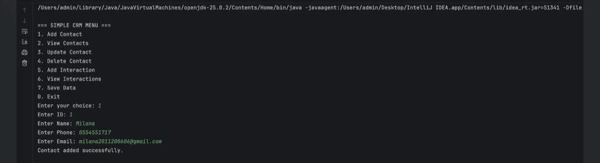
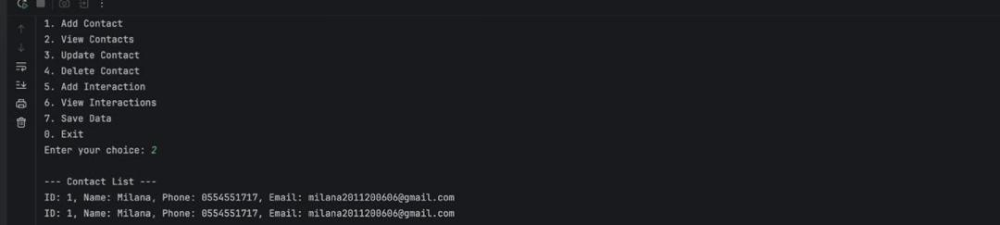
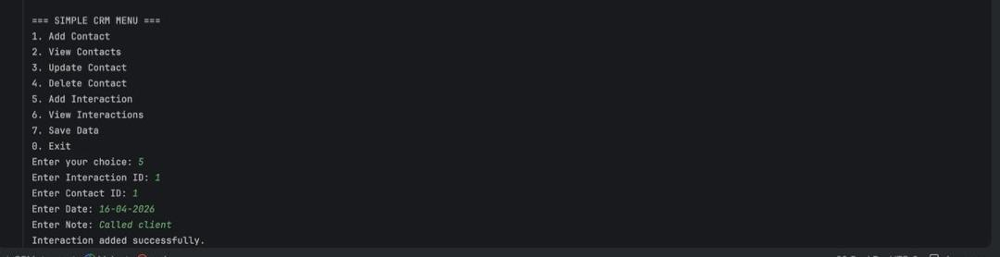
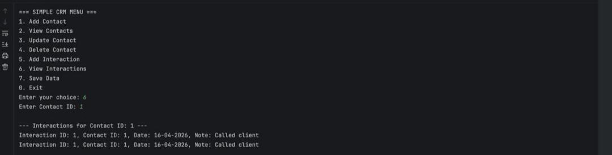
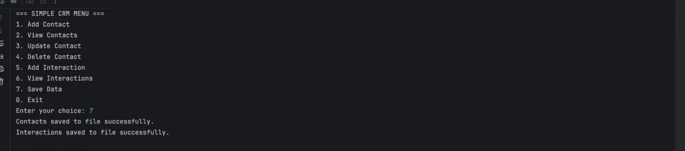
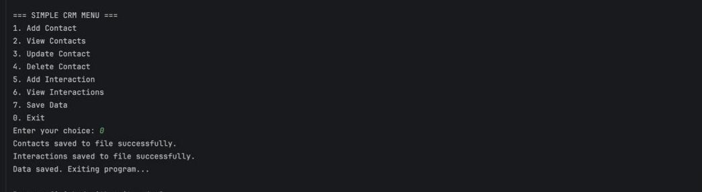

# Simple CRM System

## Student Name:
Milana Adiletova

## Description:
This project is a simplified Customer Relationship Management (CRM) system. It allows users to manage customer contacts and track interactions.

## Objectives:
- Manage customer data efficiently
- Implement CRUD operations
- Store and retrieve data from files
- Apply Object-Oriented Programming principles

## Features:
1. Add Contact
2. View Contacts
3. Update Contact
4. Delete Contact
5. Add Interaction
6. View Interactions
7. Save Data

## Technologies Used:
- Java
- IntelliJ IDEA
- File handling (TXT)

## OOP Principles:
- Encapsulation
- Inheritance
- Polymorphism

## Project Requirements:
1. CRUD operations
2. Command Line Interface
3. Input validation
4. Data persistence
5. Modular design
6. Documentation
7. Error handling
8. Encapsulation
9. Inheritance
10. Polymorphism

## Data Storage:
- contacts.txt
- interactions.txt

## Test Cases

1. Add a contact with valid data → contact is added successfully.
2. View contacts → all saved contacts are displayed.
3. Update contact → selected contact is updated successfully.
4. Delete contact → selected contact is removed successfully.
5. Add interaction → interaction is linked to the contact.
6. Save data → contacts and interactions are saved in text files.
7. Restart program → saved data is loaded again.

## Conclusion:
This project demonstrates a working CRM system using Java and OOP principles.

## Screenshots

### Add Contact


### View Contacts


### Update Contact


### Delete Contact


### Interaction


### Save


## Database (Bonus)

This project also includes a SQLite database.

Tables:
- contacts
- interactions

Example query:
```sql
SELECT * FROM contacts;

### Tables


### Data Example
